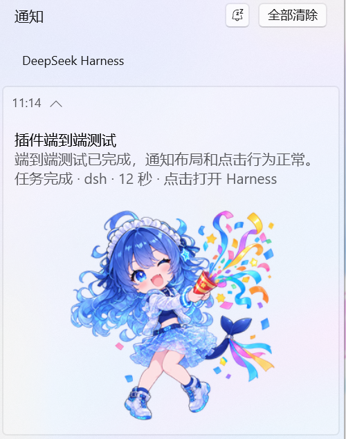

# dsh-windows-notify

Native Windows toast notifications for DeepSeek Harness: get a system reminder when a task or a background job finishes.

## Preview

Actual Notification Center capture: conversation name, task summary, status/click hint, and the 1:1 artwork below the text.

## Features

- Toast when a top-level turn completes, fails, or hits the output limit.
- Toast when a background job settles, so long builds do not need constant watching.
- Minimum duration threshold for completions (default 8 seconds; failures and output-limit notices ignore it; set 0 to notify every completion).
- Chinese / English / follow system.
- The top-left uses the DSH Desktop AUMID (com.deepseek.dsh), so Windows reads the black-and-white whale from the DeepSeek Harness Start Menu shortcut; the content no longer repeats a large logo.
- Text on top and a compact 1:1 artwork below it, with no overlap.
- The conversation name and task summary, with long text truncated.
- Optional sound.
- Clicking focuses or opens the DeepSeek Harness client through dsh://open instead of a localhost browser tab.
- Configuration page in Plugins; saves apply immediately.
- Silent no-op outside Windows.

## Install

1. Open DSH **Plugins -> Add plugin**.
2. Enter the absolute path of this directory, for example:

    E:\workspace\dsh\deepseek-plugin\dsh-windows-notify

3. Enable **Windows Task Notifications** on the Plugins page.
4. Open the row's **Configure** page and adjust the settings.

DSH installs the declared dependency @deepseek-ai/schemastery with pnpm. If the configured registry does not carry it, choose another install source in Add plugin first.

### Manual install

If Add plugin fails, link this directory into the profile and add the bundle manually:

    dsh plugin --profile desktop add E:\workspace\dsh\deepseek-plugin\dsh-windows-notify

The profile package.json must list dsh-windows-notify in dependencies and its bundles. Profiles with HMR enabled recompose when the bundle list changes; if it does not apply automatically, restart DSH.

## Default behavior

| Event | Notify by default | Notes |
| --- | --- | --- |
| Top-level turn completed | yes | Only after the minimum duration |
| Top-level turn failed | yes | Includes the provider failure summary; ignores the minimum duration |
| Top-level turn hit output limit | yes | Suggests continuing the task; ignores the minimum duration |
| Turn aborted by the user | no | Enable notifyOnAborted in cordis.patch.yml to opt in |
| Background job completed | yes | Only explicit run_in_background jobs; after the minimum duration |
| Background job failed | yes | Only explicit run_in_background jobs; includes the exit code or failure detail; ignores the minimum duration |
| Background job killed | no | Intentional cancellation stays silent |
| Subagent turn | no | The parent turn reports the overall result; opt in from Configure |
| Background job owned by a subagent | no | Same rule |

Example toast:

    Login fix
    Fixed token refresh and added regression coverage…
    Task completed · dsh · 12s · Click to open Harness

The first line is the conversation name, the second is the task summary (truncated), and the third is status/project/duration plus the click hint; the 1:1 celebration artwork sits below the text.

## Settings

| Field | Default | Meaning |
| --- | --- | --- |
| Enable notifications | true | master switch |
| Minimum duration for completions (seconds) | 8 | completed tasks shorter than this stay silent; failures and output-limit notices ignore it; 0 notifies every completion |
| Notify when a task completes | true | completed turns |
| Notify when a task fails or hits the output limit | true | error and max-tokens turns |
| Notify when a background job settles | true | job/settled |
| Also notify for subagent turns | false | subagent turns too |
| Show the task summary | true | when off, only the conversation name, status, and duration |
| Play a notification sound | true | turn off for silent toasts |
| Notification language | follow system | Chinese / English / follow system |
| App name above the toast | DeepSeek Harness | source name shown by Windows |
| Open this address when the toast is clicked | dsh://open | focuses/opens DeepSeek Harness by default; http/https also work |

Advanced fields appId, iconPath, and notifyOnAborted are available in the plugin's cordis.patch.yml or the profile's cordis.patch.yml.

## How it works

- The Host listens to turn/start, user/message, session/title, turn/end, and job/settled.
- It keeps only timing, conversation name, task summary, and shell-call state; it does not copy the session log.
- The conversation name comes from the Session title service; the task summary is the last assistant text in the turn, truncated when long.
- On turn/end or job/settled it builds ToastGeneric XML.
- Foreground shell commands are registry jobs too; only shell jobs whose arguments set run_in_background raise a toast, so long foreground commands stay quiet.
- A hidden Windows PowerShell process receives the script through -EncodedCommand, avoiding quoting and Unicode problems.
- PowerShell reuses the DSH Desktop com.deepseek.dsh identity by default; only a custom appId registers under HKCU, then calls ToastNotificationManager.Show.
- Clicking activates dsh://open, handled by DSH Desktop to focus its main window.
- Delivery is fire-and-forget and never delays or fails a turn.

## Privacy

- No network access and no telemetry.
- Reuses the DSH Desktop com.deepseek.dsh identity by default; a custom appId is the only case that registers a new HKCU identity.
- Toast text comes from the session title, the assistant summary, or user input; turn off the summary to hide it.
- The default version uses the DSH Desktop com.deepseek.dsh AUMID; do not delete the DeepSeek Harness Start Menu shortcut or that identity. Older test runs may have left HKEY_CURRENT_USER\Software\Classes\AppUserModelId\DeepSeekHarness.Notify.

## Known limitations

- The DSH Host must be running; no toast after the app closes.
- A custom appId registers per Windows user; no MSIX installer.
- Does not detect whether the DSH window is focused. Increase the minimum duration or disable completion toasts when they are noisy.
- One setting set for all top-level sessions; no per-project rules.
- The header icon depends on the DeepSeek Harness Start Menu shortcut; a pure Web deployment or a missing shortcut can leave the header icon empty.
- dsh://open depends on the DSH Desktop dsh protocol; pure Web deployments may need an http(s) URL.
- Clicking focuses/opens Harness only; it cannot target a specific conversation.

## Files

- index.js: Host entry and Session listeners.
- notify.js: Toast XML, PowerShell command, summary/planner logic.
- client.js: Plugins-page configuration.
- assets/dsh-whale.png: fallback black-and-white DSH whale icon for a custom appId.
- assets/celebrate.png: 1:1 celebration artwork below the text (256x256, fully visible).
- assets/notification-preview.png: actual Notification Center capture used in this README.
- icon.png: Plugins-page icon (512x512, same source artwork).
- cordis.patch.yml: defaults.

## License

Code is MIT; see LICENSE.

assets/celebrate.png, icon.png, and assets/notification-preview.png use the image supplied with this request; the header icon comes from the official DeepSeek Harness black-and-white whale. Confirm redistribution and commercial rights for the image assets before republishing.
