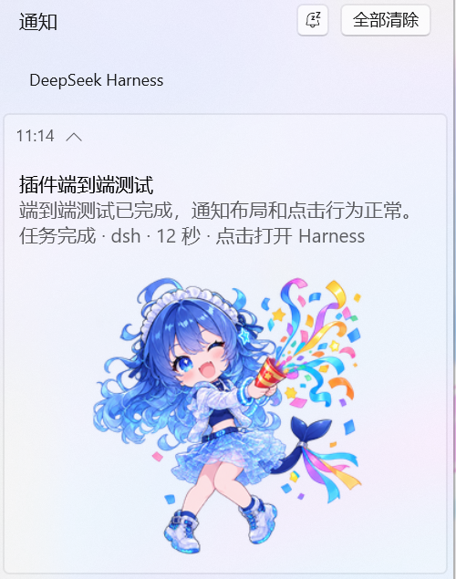

# dsh-windows-notify

给 DeepSeek Harness 加上 Windows 系统通知：任务结束或后台任务完成时，弹一条原生 Toast 提醒。

这是一个独立的 DSH 插件，和 dsh-subagent-custom-dispatch 没有依赖关系。

## 效果预览

实际通知中心效果：对话名、任务总结、状态/点击提示，1:1 图片放在文字下方。

## 功能

- 任务完成、任务出错、达到输出上限时提醒。
- 后台任务（job/settled）完成或失败时提醒，长任务不用一直盯着窗口。
- 最短时长阈值：默认 8 秒，短对话不打扰；失败和达到输出上限会立即提醒；设为 0 表示完成类任务也每次提醒。
- 中文 / English / 跟随系统。
- 左上角使用 DSH Desktop 的 AUMID（com.deepseek.dsh），从「DeepSeek Harness」开始菜单快捷方式读取黑白鲸鱼图标；内容区不再重复放大图标。
- 内容区文字在上，1:1 原图缩小后放在文字下方，不与文字重叠。
- 文字显示对话名和该次任务的总结，过长自动省略。
- 可选提示音。
- 点击通知聚焦/打开 DeepSeek Harness 客户端（dsh://open），不再用浏览器打开 localhost。
- 插件页面可视化配置，保存即生效。
- 非 Windows 环境自动静默，不报错。

## 安装

1. 打开 DSH 侧边栏 **Plugins → Add plugin**。
2. 在安装输入框里填本目录的绝对路径，例如：

    E:\workspace\dsh\deepseek-plugin\dsh-windows-notify

3. 安装完成后，在 **Plugins** 页面启用 **Windows 任务通知**。
4. 点插件行上的 **Configure**，按需调整。

DSH 安装时会用 pnpm 安装插件依赖 @deepseek-ai/schemastery。如果安装源里没有这个包，先在 Add plugin 里切换安装源。

### 手动安装（可选）

如果 Add plugin 失败，也可以把本目录链接进 profile，然后手动加入 bundle：

    dsh plugin --profile desktop add E:\workspace\dsh\deepseek-plugin\dsh-windows-notify

profile 的 package.json 里需要出现这条依赖，bundles 里需要出现 dsh-windows-notify。已启用 HMR 的 profile 会在 bundle 列表变化时自动重组；如果没有自动生效，重启 DSH。

## 通知外观

- 左上角应用图标：默认使用 DSH Desktop 的 AUMID `com.deepseek.dsh`，Windows 从「DeepSeek Harness」开始菜单快捷方式读取官方黑白鲸鱼图标。
- 只有配置了自定义 appId 时，才使用 assets/dsh-whale.png 作为备用图标。
- 内容区：上方是对话名和任务总结，下方是 assets/celebrate.png（本次提供的蓝发少女图片），保持 1:1 原比例，缩到 256×256 完整显示。
- 内容区不放 appLogoOverride，避免与头部图标重复、占用文字宽度；同时给 visual/binding 加 branding="none"，尽量去掉 Windows 自动加的“应用名 / 新通知”块。
- 插件图标使用同一张庆祝图：icon.png（512×512）。
- 下方图片是本地文件，不需要联网，也不会被上传。
- 点击通知会调用 dsh://open，由 DSH Desktop 聚焦主窗口；纯 Web 部署可把 clickUrl 改成 http(s) 地址。

## 默认行为

| 场景 | 默认是否提醒 | 说明 |
| --- | --- | --- |
| 顶层会话任务完成 | 是 | 任务运行超过 8 秒才提醒 |
| 顶层会话任务出错 | 是 | 附带错误信息摘要；不受最短时长限制 |
| 顶层会话达到输出上限 | 是 | 提示可以继续让它做；不受最短时长限制 |
| 用户主动中断 | 否 | 可在 cordis.patch.yml 里打开 notifyOnAborted |
| 后台任务完成 | 是 | 仅显式 run_in_background 的任务；运行超过 8 秒才提醒 |
| 后台任务失败 | 是 | 仅显式 run_in_background 的任务；附带退出码或失败原因；不受最短时长限制 |
| 后台任务被取消 | 否 | 主动 kill 不提醒 |
| 子智能体轮次 | 否 | 父任务结束时会统一提醒；可在配置里打开 |
| 子智能体名下的后台任务 | 否 | 同上 |

通知内容示例：

    登录修复
    已修复 token 刷新逻辑，并补充了回归测试…
    任务完成 · dsh · 12 秒 · 点击打开 Harness

第一行是对话名，第二行是任务总结（超出部分省略），第三行是状态/项目/耗时/点击提示；下方是 1:1 完整显示的庆祝图片。

## 配置项

在 **Plugins → Windows 任务通知 → 行 windows-notify → Configure** 里修改：

| 字段 | 默认值 | 含义 |
| --- | --- | --- |
| 启用通知 | true | 总开关 |
| 完成类提醒最短时长（秒） | 8 | 完成类任务短于该时长不提醒；失败和输出上限不受限制；0 表示每次都提醒 |
| 任务完成时提醒 | true | completed 轮次 |
| 任务出错或达到输出上限时提醒 | true | error 和 max-tokens 轮次 |
| 后台任务结束时提醒 | true | job/settled |
| 子智能体结束时也提醒 | false | 子智能体轮次也弹通知 |
| 显示任务总结 | true | 关闭后只显示对话名、状态和耗时 |
| 播放提示音 | true | 关闭后静音 |
| 通知语言 | 跟随系统 | 中文 / English / 跟随系统 |
| 通知中的应用名称 | DeepSeek Harness | Windows 通知顶部显示的应用名 |
| 点击通知打开的地址 | dsh://open | 默认聚焦/打开 DeepSeek Harness；也支持 http/https |

高级字段 appId、iconPath、notifyOnAborted 不放在可视化页面里，可以在 plugin 的 cordis.patch.yml 或 profile 的 cordis.patch.yml 中覆盖。

## 测试

在插件目录里直接跑一个真实 Toast：

    node tests/toast-smoke.mjs

不弹通知时，先检查 Windows 设置：

1. **设置 → 系统 → 通知**，确认通知总开关打开，并允许 **DeepSeek Harness** 发通知。
2. 检查专注助手 / 勿扰模式是否拦截。
3. 通知可能只进通知中心，不弹横幅；点开通知中心确认。
4. 确认 DSH 的 Host 进程运行在 Windows 上；浏览器在别的机器上打开 DSH 时，Toast 出现在 Host 机器。

插件用 Windows PowerShell 5.1 的 WinRT Toast API。PowerShell 7 加载不了这些 WinRT 类型，所以插件固定调用：

    C:\Windows\System32\WindowsPowerShell\v1.0\powershell.exe

Windows 10/11 默认自带 5.1。如果系统里没有它，Toast 会失败并写入 DSH 日志。

## 原理

- Host 侧监听 Session 的 turn/start、user/message、session/title、turn/end 和 job/settled 事件。
- 只保留计时、对话名、任务总结和 shell 调用所需的最小状态，不复制会话日志。
- 对话名从 Session title service 读取；任务总结取本轮最后一条 assistant 文本，过长自动省略。
- 在 turn/end 或 job/settled 时组装 Toast XML。
- 前台 shell 命令也会注册成 job；插件只对参数里显式 run_in_background 的 shell job 提醒，避免每条长命令都弹通知。
- 通过 node:child_process 启动一个隐藏窗口的 Windows PowerShell，用 -EncodedCommand 传入脚本，避免中文和引号转义问题。
- PowerShell 在 HKCU 注册 AppUserModelID（DeepSeekHarness.Notify），然后调用 ToastNotificationManager.Show。
- 点击通知使用 dsh://open，由 DSH Desktop 聚焦主窗口。
- 发送是 fire-and-forget，不会阻塞或影响任务。

## 隐私与安全

- 不联网；不向任何服务上报内容。
- 默认复用 DSH Desktop 的 com.deepseek.dsh 标识，不额外注册新的通知身份；自定义 appId 才会在 HKCU 注册。
- 通知正文来自对话名、任务总结或用户输入；不想显示总结时关闭“显示任务总结”。
- 卸载后如需清理注册表，可删除：

    HKEY_CURRENT_USER\Software\Classes\AppUserModelId\DeepSeekHarness.Notify

当前版本使用 DSH Desktop 的 com.deepseek.dsh，不要删除 DSH 自己的开始菜单快捷方式或该 AUMID。

## 已知限制

- DSH Host 必须保持运行；应用关闭后没有通知。
- 只按当前 Windows 用户注册通知标识，不提供 MSIX/安装包。
- 不检测 DSH 窗口是否在前台；如果觉得打扰，调大最短提醒时长或关闭任务完成提醒。
- 所有顶层会话共用一套设置，暂不支持按项目分别配置。
- 头部图标依赖 DSH Desktop 的「DeepSeek Harness」开始菜单快捷方式；纯 Web 部署或缺少该快捷方式时，头部可能没有图标。
- `dsh://open` 依赖 DSH Desktop 注册的 dsh 协议；纯 Web 部署下点击可能无效，可改成 http(s) 地址。
- 点击只能聚焦/打开 Harness，不能直接定位到具体会话。

## 目录

- index.js：Host 插件入口，注册 Session 监听。
- notify.js：Toast XML、PowerShell 脚本、时长/语言/计划逻辑。
- client.js：Plugins 页配置卡片。
- assets/dsh-whale.png：自定义 appId 时的备用黑白 DSH 鲸鱼图标。
- assets/celebrate.png：文字下方的 1:1 庆祝图片（256×256，完整显示）。
- assets/notification-preview.png：README 里的实际通知中心截图。
- icon.png：Plugins 页使用的插件图标（512×512，与 celebrate.png 同源）。
- cordis.patch.yml：默认配置。
- locale/zh.json、locale/en.json：插件列表里的名称和描述。
- tests/：单元测试、客户端冒烟测试、真实 Toast 测试。

## 开发

    cd E:\workspace\dsh\deepseek-plugin\dsh-windows-notify
    node --test tests/notify.test.mjs
    node tests/client-smoke.mjs
    node tests/toast-smoke.mjs

Host 集成冒烟测试需要先安装依赖：

    node tests/integration-smoke.mjs
    node tests/end-to-end.mjs

## 许可

代码 MIT，见 LICENSE。

assets/celebrate.png、icon.png 和 assets/notification-preview.png 使用本次请求提供的图片；头部图标来自 DeepSeek Harness 官方黑白鲸鱼图标。图片素材的再分发和商用授权由使用者自行确认。
